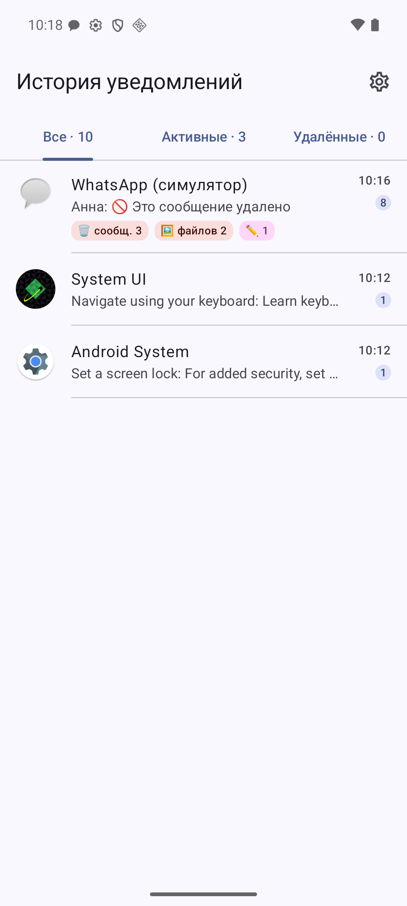
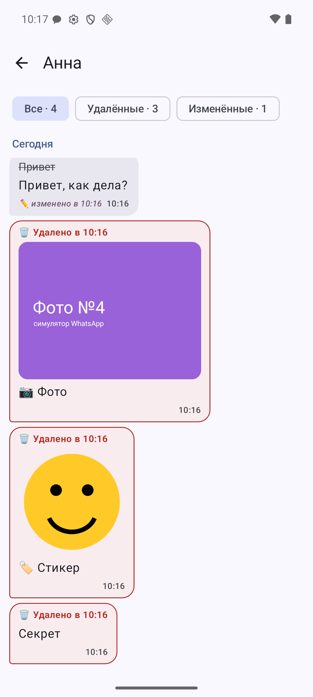
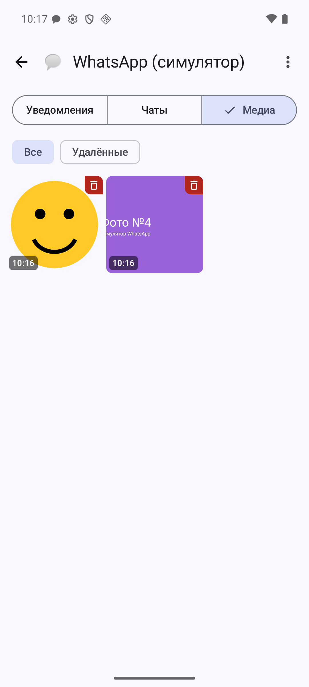
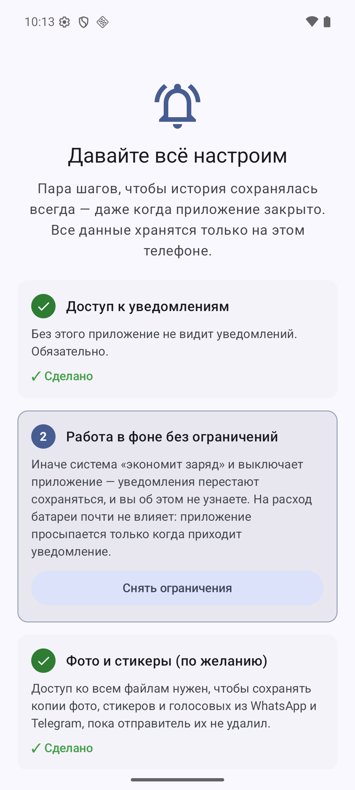

# История уведомлений

Android-приложение, которое сохраняет все входящие уведомления — даже те, что были смахнуты, удалены отправителем или отредактированы.

<p align="center">
  
  
  
  
</p>

## Возможности

- **История всех уведомлений** — сгруппирована по приложениям, с разделением на активные и удалённые.
- **Причина исчезновения** — смахнуто, очищено, открыто, удалено приложением, истёк срок и т.д.
- **Удалённые сообщения** — если собеседник удалил сообщение в WhatsApp или Telegram, его текст остаётся в истории с пометкой «🗑 Удалено».
- **Отредактированные сообщения** — видна исходная версия: ~~Привет~~ → Привет, как дела? ✏️
- **Удалённые фото и стикеры** — входящие медиа копируются сразу, поэтому сохраняются даже после удаления «для всех».
- **Выбор приложений** — можно отключить сохранение для любых приложений, с поиском и массовым выбором.
- **Срок хранения** — 7 / 30 / 90 дней или бессрочно.
- **Работа в фоне** — пошаговая настройка при первом запуске (доступ к уведомлениям, ограничения батареи, автозапуск на Xiaomi/Huawei/Oppo/Vivo).
- Material You, светлая и тёмная тема, плавные анимации.

Все данные хранятся только на устройстве и никуда не отправляются.

## Установка

1. Скачайте APK из раздела [Releases](../../releases/latest).
2. Установите и откройте приложение — оно проведёт по всем шагам настройки.

> Если переключатель «Доступ к уведомлениям» неактивен: «О приложении» → ⋮ → «Разрешить ограниченные настройки».

## Требования

- Android 8.0+ (рассчитано на Android 16)
- Копии медиафайлов — Android 11+, разрешение «Доступ ко всем файлам» и включённая автозагрузка медиа в мессенджере

## Поддерживаемые мессенджеры

| Мессенджер | Удалённые / изменённые сообщения | Копии фото и стикеров |
|---|---|---|
| WhatsApp, WhatsApp Business | ✅ | ✅ |
| Telegram, AyuGram | ✅ | только то, что сохраняется в галерею |
| Остальные (VK, Viber и др.) | ✅ если уведомления в виде переписки | — |

## Ограничения

- Сохраняется только то, что пришло уведомлением: если чат открыт на экране, уведомлений нет.
- Если вы сами удалите фото в мессенджере, копия тоже будет помечена как удалённая.
- Android 15+ скрывает от сторонних приложений одноразовые коды из SMS и банков.

## Сборка

```bash
./gradlew assembleRelease
```

Для подписи релиза создайте `keystore.properties` в корне проекта:

```properties
storeFile=../keystore/release.jks
storePassword=...
keyAlias=...
keyPassword=...
```

Без этого файла release-сборка подписывается debug-ключом.

Модуль `simulator` — тестовый мессенджер для эмулятора, имитирующий уведомления WhatsApp (правки, удаления, фото). На реальное устройство его не устанавливать.

## Стек

Kotlin · Jetpack Compose · Material 3 · NotificationListenerService · SQLite

## Автор

Nagmetov
